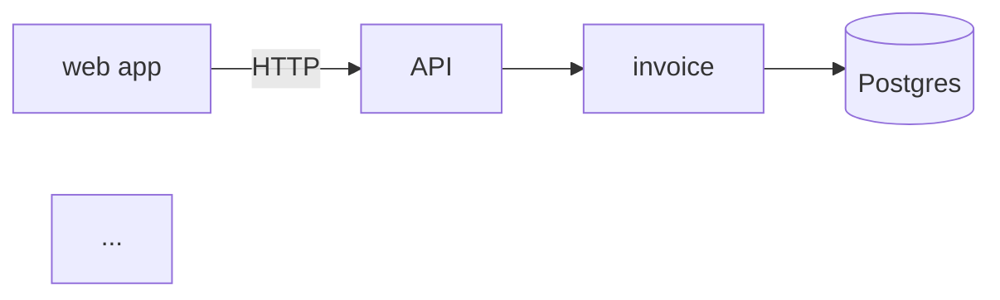

# Project handbook: templates and rules

The handbook replaces the person who left. Write it for a capable developer who joins next month and has
never seen this code: they should be able to read `README.md`, follow links, and understand any part of the
system end to end without asking anyone.

## Contents

1. Folder layout and naming
2. Linking rules ("every point connected")
3. Page templates: README, architecture, module, flow, data-model, integrations, config, jobs, history, risks, glossary
4. `.meta.json`
5. Quality bar and large repos

## 1. Folder layout and naming

```
docs/project-brain/
  README.md          start here
  architecture.md
  modules/<slug>.md  one per module from `arch.py map`
  flows/<slug>.md    one per user-facing feature or background process
  data-model.md
  integrations.md
  config.md
  jobs.md
  history.md
  risks.md
  glossary.md
  .meta.json
```

- Slugs are lowercase and hyphenated, taken from the module or feature name: `api-invoice.md`, `web-pages.md`,
  `login.md`, `create-invoice.md`. Prefix with the app (`api-`, `web-`, `worker-`) when a monorepo has several.
- Use relative links (`../modules/api-invoice.md`), never absolute paths or URLs to the repo host, so the
  handbook works in any clone, fork or editor preview.
- Cite code as inline code with repo-root-relative paths: `` `api/src/invoice/invoice.service.ts:34-44` ``.
  Cite commits as `` `2bf6e4d44` `` with the subject in quotes. `arch.py verify --docs` checks both formats.

## 2. Linking rules ("every point connected")

The value of the handbook is in its connections. A fact that sits on one page with no links is only half
useful, so:

- Every page ends with a **Connected to** section that links to every related page: module ↔ the flows that
  pass through it ↔ the entities it reads or writes ↔ the integrations it calls ↔ the decisions that shaped it ↔
  the people who know it.
- Links go both ways. When a flow page links to `modules/api-invoice.md`, that module page lists the flow under
  "Flows through here". Fix the reverse link when you write the second page.
- The first mention of a module, entity, flow or term on a page is a link; later mentions can be plain text.
- `README.md` links to every page. No page may be an orphan.

## 3. Page templates

Headings are fixed so readers (and later refreshes) can find things. Leave out a section only if it truly
does not apply, and write "None found" when you checked and found nothing. That tells the reader you looked.

### README.md

````markdown
# <Project name>: project brain

<2-4 sentences: what the system does, for whom, and its shape (e.g. "a NestJS API, a React web app and a
Python worker sharing one Postgres database").>

Built from commit `<sha>` on <date>. Refresh with the archaeologist skill ("update the handbook").

## Map


## Start here
1. [Architecture](architecture.md): the 10-minute overview
2. [Most important flow](flows/<slug>.md)
3. ...

## All pages
- Modules: [invoice](modules/api-invoice.md), ...
- Flows: ...
- [Data model](data-model.md) · [Integrations](integrations.md) · [Config](config.md) · [Jobs](jobs.md)
- [History](history.md) · [Risks](risks.md) · [Glossary](glossary.md)

## Run it locally
<from package.json scripts / Makefile / docker-compose / README, citing where each command comes from>

## Ask questions
Ask your coding agent, e.g. "what breaks if I delete api/src/invoice/invoice.service.ts?" or "why does markPaid
check paidAt?". The archaeologist skill answers from this handbook plus the current code, with evidence.
````

### architecture.md

````markdown
# Architecture

## Shape
<apps/packages, languages, frameworks (from `overview`), how they talk (HTTP, queues, shared DB)>

## Modules and dependencies
```mermaid
graph TD
  <one node per module from `map`, edges from module_edges; label hubs>
```
| Module | Responsibility (one line) | Depends on | Used by |
| --- | --- | --- | --- |

## Entry points
<from `overview` entry_files, `routes`, `jobs`: where execution starts and why>

## Cross-cutting concerns
<auth, tenant isolation, error handling, logging, config loading: where each lives (`path:line`)>

## Connected to
````

### modules/<slug>.md

```markdown
# <module name> (`<module path>`)

**In one sentence:** <what this module is responsible for>

## Responsibilities
- <bullets, each with a `path:line`>

## Key files
| File | What it does | Imported by |
| --- | --- | --- |

## Public surface
<exports other modules use (from `dependents` / `impact`), routes it serves, events or jobs it owns>

## Depends on / Used by
- Depends on: [other module](other.md) for <why>, external packages <...>
- Used by: [module](...) via `file:line`

## Data and integrations
<tables read/written (link data-model.md#entity), external APIs (link integrations.md), env vars (link config.md)>

## Flows through here
- [Create invoice](../flows/create-invoice.md): step 4-6

## Gotchas
<surprising logic, with `why`/`blame` evidence: "markPaid returns early if paidAt is set: added in `2bf6e4d44`
'fix: prevent double payment on webhook retry (#42)' because Stripe retries webhooks">

## History and people
<when created (timeline milestone), key decisions (`decisions <path>`), owners; flag inactive ones as knowledge at risk>

## Tests
<test files and what they cover, or "None found">

## Connected to
```

### flows/<slug>.md

````markdown
# <Flow name, in user terms: "User logs in">

**Trigger:** <UI element / route / cron / webhook> · **Ends at:** <tables, external services>

## Steps
1. User clicks **Log in** → `handleLogin` (`web/src/pages/Login.tsx:9`)
2. `POST /api/auth/login` via `api` (baseURL `/api`, `web/src/api.ts:3`)
3. No guard (public route: `api/src/auth/auth.controller.ts:8`)
4. `AuthService.login` looks up the user (`api/src/auth/auth.service.ts:11`), table **User** (read)
5. ...

```mermaid
sequenceDiagram
  participant UI as Login.tsx
  participant API as AuthController
  ...
```

## Data touched
| Entity | Read/Write | Where |
| --- | --- | --- |

## Failure modes
<what happens on bad input, missing tenant, external API down, retries/idempotency, with evidence>

## Not determined
<dynamic parts you could not trace statically>

## Connected to
````

### data-model.md

```markdown
# Data model
<where the schema lives (`models` output, migrations dirs)>

## <Entity>
- Defined at `path:line` · key fields: ...
- Written by: [module](modules/...) (`path:line`) · Read by: ...
- Used in flows: ...
- Notes: tenant scoping, soft deletes, indexes, odd fields (with `why` evidence)

## Connected to
```

### integrations.md

For each external service from `sinks`: what it is used for, where it is called (`path:line`), the config/env it
needs (link config.md), failure handling and retries, and which flows depend on it.

### config.md

A table built from `env`: variable · where it is read · declared in (.env.example …) · default · what breaks if it is
missing. Call out "declared but never read" and "read but not declared" rows. Never copy values; secrets may be
in committed `.env` files.

### jobs.md

For each job/queue/webhook (`jobs`, webhook routes): schedule or trigger, handler (`path:line`), what it reads or
writes, idempotency, and what happens if it fails or runs twice.

### history.md

```markdown
# History

## Timeline
| Period | Commits | Who | What happened |
| --- | --- | --- | --- |
<from `timeline`; summarize each quarter in words, cite notable commits>

## Milestones
<from timeline milestones: when each module appeared, by whom, which PR>

## Key decisions and why
<from `decisions`: one bullet per decision: what changed, the quoted reason, `sha`, link the affected module>

## Incidents, hotfixes and reverts
<fix/hotfix/revert commits: what broke, what was done, what was reverted and why>

## People and knowledge at risk
| Person | Active | Worked on | Last commit |
| --- | --- | --- | --- |
<from `people`>
**Knowledge at risk:** <from `orphans`: areas whose main author is inactive, with who else has touched them;
these pages deserve the most care because nobody is left to ask>

## Connected to
```

### risks.md

Sections: **Hubs** (files with HIGH `impact`, and what depends on them) · **Auth/tenant gaps** (`routes
--missing-guard`, after reading each handler) · **Knowledge at risk** (`orphans`) · **Churn hot spots** (hot files
from `overview`) · **Potentially unused code** (`unused`) · **Duplicated logic** (`dupes`, and whether the copies
have already diverged) · **Hidden coupling** (`cochange` partners without import links). Each item: evidence,
why it matters, a suggested next step.

### glossary.md

| Term (business language) | In code | Where | Page |
| --- | --- | --- | --- |
| Invoice | `Invoice` model, `InvoiceService` | `api/prisma/schema.prisma:17` | [invoice](modules/api-invoice.md) |

## 4. `.meta.json`

```json
{
  "built_from": "<git rev-parse HEAD>",
  "built_at": "<YYYY-MM-DD>",
  "generator": "ai-archaeologist",
  "pages": ["README.md", "architecture.md", "modules/api-invoice.md", "..."],
  "not_covered": ["<modules skipped in a partial build>"]
}
```

Refresh reads `built_from` to run `arch.py changed-since <built_from>`.

## 5. Quality bar and large repos

A page is done when:

- every factual sentence has a `path:line`, route or commit, or is marked as inference
- someone new could change this part of the code safely after reading it, or knows exactly what to read next
- its **Connected to** section links both ways
- `arch.py verify --docs docs/project-brain` reports no problems

Size: module pages usually run 40-150 lines and flow pages 30-100. Prefer a table to prose for lists of files,
routes or env vars.

Large repos (more than about 25 modules or 100 routes): build in passes. The first pass covers README,
architecture, history, risks, and the top modules and flows by `map` importance. List the rest under
`not_covered` in `.meta.json` and offer to continue. If your agent can run sub-tasks in parallel, module pages
are independent enough to hand out, one module per task, each told to follow this file.
